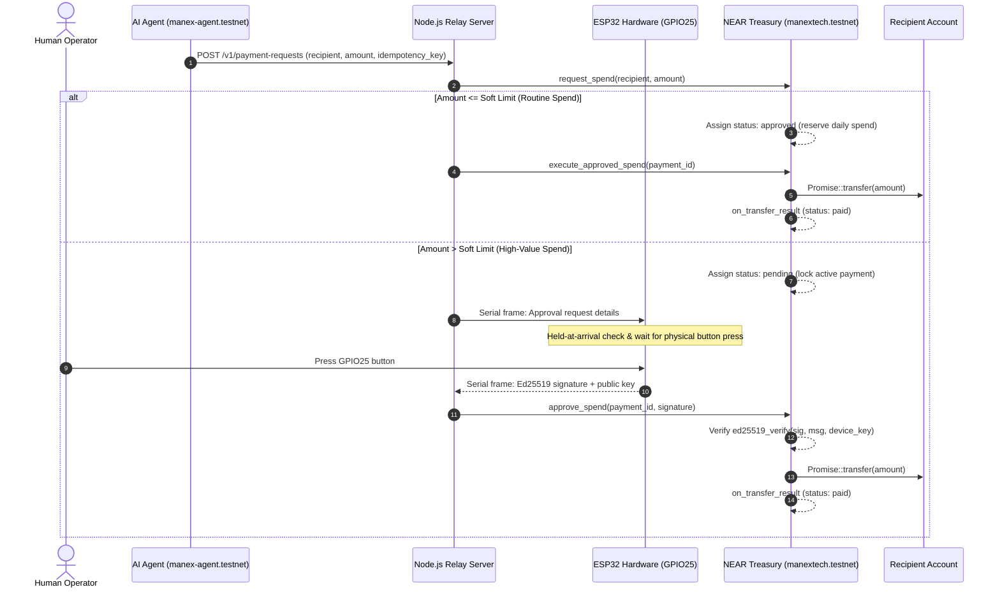

# Tapproved

[](https://explorer.testnet.near.org/accounts/manextech.testnet)
[](https://explorer.testnet.near.org/accounts/manextech.testnet)
[](https://explorer.testnet.near.org/accounts/manex-agent.testnet)
[](https://github.com/manex-tech/tapproved/actions/workflows/ci.yml)
[](LICENSE)

> **Built for NEAR HACKATHON**  
> Tracks: **AI Security & Defense** (`security`) and **Agent Economy** (`agents`).  
> **Testnet only. Unaudited.** Do not use real funds.  
>
> **Hardware-backed spending authorization for autonomous AI agents on NEAR.** Routine payments execute automatically within strict policy limits; elevated payments require a physical button press on an ESP32 hardware device generating an Ed25519 signature.

---

## Project Context & Disclosures

### Origin

Tapproved grew out of earlier experimentation in [near-tap](https://github.com/manex-tech/near-tap), but **no source code, contract modules, firmware, tests, or other implementation files were carried over**; Tapproved is a separate implementation. The NEAR Testnet account `manextech.testnet` previously hosted an attendance prototype, and its legacy records remain in account storage. The contract's `migrate()` method was a one-time, guarded migration of that existing state to the Tapproved schema; it was not a migration of near-tap source code.

### AI-assisted development disclosure

AI tools assisted with implementation, debugging, test development, and documentation. The project maintainer remains responsible for the code, design decisions, test evidence, and submission. AI assistance is not an independent security review or audit.

### Third-party libraries

Direct dependencies include `near-api-js 7.3.1` and `serialport 12.0.0` (Node.js); `near-sdk 5.17.2` and `borsh 1.5.7` (Rust contract); and `Crypto 0.4.0` and `ArduinoJson 7.2.1` (ESP32 firmware). The firmware build uses PlatformIO's `espressif32 6.10.0` platform. See `package-lock.json`, `contract/Cargo.toml`, and `firmware/platformio.ini` for pinned dependency declarations and transitive dependency details.

### Known limitations

- **Blind signing / display trust:** the ESP32 has no trusted display. Payment details are presented through host-controlled USB serial, so a compromised host can misrepresent what the physical button press authorizes. A directly driven trusted display is not implemented; see the [Threat Model, H10](docs/SECURITY-THREAT-MODEL.md).
- **Extractable device key:** the Ed25519 seed is stored in ordinary ESP32 NVS. Flash encryption and secure boot are not configured, so physical flash/debug access may expose the key. See the [ESP32 Security Assessment](docs/ESP32-SECURITY-ASSESSMENT.md).
- **Testnet only:** the contract, agent, and documented flows target NEAR Testnet. No mainnet deployment is supported.
- **Autonomous soft-limit exposure:** a compromised agent key or relay can make allowlisted soft-limit payments autonomously up to the remaining daily spending cap. Payments above the soft limit require a valid device signature.
- **Unaudited:** no independent smart-contract, firmware, or application security audit has been completed.

---

## 1. Problem & Innovation

| The AI Agent Dilemma | The Tapproved Solution |
|---|---|
| **Full Custody (Unsafe)**: Granting an AI agent an unconstrained private key means prompt injections, hallucinated transactions, or leaked credentials can drain an entire treasury in seconds. | **Tiered On-Chain Policy**: Routine transactions (`<= soft_limit_yocto`) execute autonomously; high-value payments (`> soft_limit_yocto`) are locked in `pending` on-chain until physically authorized. |
| **Full Human-in-the-Loop (Slow)**: Forcing human confirmation for every micropayment destroys autonomy and creates operational friction. | **Autonomous Within Guardrails**: Agents spend freely within pre-configured per-payment and daily spending limits, paying only allowlisted partner accounts. |
| **Software Approvals (Vulnerable)**: Traditional 2FA and push notifications to smartphones or browsers are susceptible to phishing, session hijacking, and host compromise. | **Physical Hardware Isolation**: Ed25519 private keys reside on an isolated ESP32 device that signs only after a physical button press (GPIO25). |

---

## 2. Concrete Role of NEAR Protocol

> *Why Tapproved requires NEAR — and cannot be built simply on traditional EVM or Web2 rails:*

1. **Granular Function Call Access Keys**: NEAR allows `manex-agent.testnet` to hold access keys strictly scoped to `request_spend` and `execute_approved_spend` on `manextech.testnet`. The agent physically cannot transfer account ownership, re-key the contract, or call unauthorized contract methods.
2. **On-Chain Policy Engine in Smart Contract**: The `manextech.testnet` Rust contract enforces strict soft limits (0.01 NEAR), hard limits (0.1 NEAR), daily quotas (0.5 NEAR), and allowlisted recipient addresses at the runtime level. An agent cannot bypass these rules because validation occurs before any transfer promise is initiated.
3. **Native Host Ed25519 Verification (`near_sdk::env::ed25519_verify`)**: High-value payments require an Ed25519 signature generated exclusively inside the isolated ESP32 hardware token. The NEAR runtime provides native cryptographic verification of this signature against the registered `device_public_key` with zero external oracle dependency.
4. **Asynchronous Cross-Contract Promise Settlement**: Two-phase spending ensures funds are reserved on-chain and only transferred via `Promise::create`. An asynchronous callback (`on_transfer_result`) reconciles daily reservations or rolls back state atomically if the recipient transfer fails or expires.
5. **Protocol Storage Economics**: NEAR's storage staking model is actively managed via `get_storage_metrics`, ensuring the treasury maintains sufficient storage headroom (~2.42 NEAR) while pruning expired payment nonces after 90 days.

---

## 3. System Architecture



---

## 4. Verified Live Testnet Evidence

All components of Tapproved are live and verified on **NEAR Testnet**:

| Milestone | Entity / Method | Live Explorer Link & Hash |
|---|---|---|
| **Treasury Contract** | Account | [`manextech.testnet`](https://explorer.testnet.near.org/accounts/manextech.testnet) |
| **Registered Agent** | Account | [`manex-agent.testnet`](https://explorer.testnet.near.org/accounts/manex-agent.testnet) |
| **Contract Deployment** | Wasm Code Hash | `Amp87jC1DCJjyA5bsmfEpFQzuqu72Cw7NSLRNk8uh3R5` ([Tx](https://explorer.testnet.near.org/transactions/4psHQnNteqE8SR6g9dBnSeu4smnpt3hDqXjFkzU3kzkU)) |
| **In-Place State Migration** | Guarded `migrate()` | [Tx `4AXh7BEC...`](https://explorer.testnet.near.org/transactions/4AXh7BECjmMy2X7JCmS8G3UdXbXvJMNzJNDrj6Cq87Sh) (Gas: 0.309 Tgas) |
| **Allowlist Expansion** | `add_allowed_recipient` | [Tx `CTT3bGrY...`](https://explorer.testnet.near.org/transactions/CTT3bGrY1pzw276BTwVotsoP9A9WpnzGj8z5tTXtafDp) |
| **Autonomous Request #4** | `request_spend(0.001 NEAR)` | [Tx `6FY3y24t...`](https://explorer.testnet.near.org/transactions/6FY3y24tZ21Yb8vgDsHkMQU8qqYCuo6ESeJoybLUTFUu) |
| **Settlement & Callback #4** | `execute_approved_spend(4)` | [Tx `C5fZ7UW8...`](https://explorer.testnet.near.org/transactions/C5fZ7UW8TW3nSwv8EhD4gh8GdmUpMdqvCjHAGA1fkUNi) |
| **Autonomous Request #10** | `request_spend(0.005 NEAR)` | [Tx `GtxfhED8...`](https://explorer.testnet.near.org/transactions/GtxfhED8E3VZmH8Av9G3riuLo24bcFfPmJAVMLKLxDaS) |
| **Autonomous Settlement #10** | `execute_approved_spend(10)` | [Tx `EpGEwmDA...`](https://explorer.testnet.near.org/transactions/EpGEwmDAQs8mJddqiC95y4hMYVmd7XFU7UCRHUTM5EC1) |
| **Hardware-Gated Request #11** | `request_spend(0.055 NEAR)` | [Tx `7zkK6JNu...`](https://explorer.testnet.near.org/transactions/7zkK6JNuwp7qFcNf4CTcH2UFiVco8JnvdY7hzuECjU25) |
| **First Hardware Approval #3** | ESP32 Button Approval | [Milestone Report](docs/TESTNET-HARDWARE-APPROVAL-MILESTONE.md) |

---

## 5. 3-Minute Quickstart & Deterministic Judge Runbook

> **For Machine Readers (Claude Code / Codex) and Human Judges:**  
> Follow these deterministic **"Do X → See Y"** steps to verify Tapproved in under 3 minutes.

### Step 1: Automated Test Suite Verification
Verify the entire codebase, cryptographic primitives, idempotency store, and SDK without requiring network access:
- **Do:**
  ```bash
  git clone https://github.com/manex-tech/tapproved.git
  cd tapproved
  npm ci
  npm run check
  cargo test --manifest-path contract/Cargo.toml
  ```
- **See:**
  - `npm run check`: **169 Node.js tests passed, 0 failed** across relay, SDK, protocol vectors, dashboard service, and autonomous-agent mocks.
  - `cargo test`: **83 Rust unit tests passed, 0 failed** verifying smart contract logic, soft/hard limit assertions, and Ed25519 verification.

*Evidence boundary:* live NEAR Testnet transactions listed in §4 are network evidence, not sandbox integration tests. This repository has no sandbox integration-test suite; local Node and Rust tests are unit/mock tests.

---

### Step 2: Autonomous AI Agent Simulation Demo
Runs a deterministic local simulation without physical hardware, a `.env` file, or live NEAR transactions. The command starts an ephemeral relay in-process and uses a local policy/payment adapter:
- **Do:**
  ```bash
  npm run agent:autonomous
  ```
- **See:**
  ```text
  [Agent] Connecting to Tapproved relay and fetching policy...
  [Agent] Policy loaded: Soft Limit = 10000000000000000000000 yoctoNEAR, Hard Limit = 100000000000000000000000 yoctoNEAR
  [Agent] Allowlisted recipients: ["manextech.testnet","manex-agent.testnet"]

  --- Scenario 1: Autonomous Routine Spending (Within Soft Limit) ---
  [Agent] Requesting 5000000000000000000000 yoctoNEAR to manextech.testnet
  [Agent] Request status: paid (replayed=false)

  --- Scenario 2: Elevated Spending Requiring Hardware Approval ---
  [Agent] Requesting 55000000000000000000000 yoctoNEAR to manextech.testnet
  [Agent] Payment 11 is PENDING! Physical button confirmation required on ESP32.

  --- Scenario 3: Restricted Spending Rejection ---
  [Agent] Attempting spend to unauthorized recipient: unauthorized-merchant.testnet
  [Agent] Successfully blocked by policy enforcement: recipient unauthorized-merchant.testnet is not allowlisted

  [Agent] Lifecycle demo completed successfully.
  ```

---

### Step 3: Interactive Real-Time Monitoring Dashboard
Launches the relay server and the operator web dashboard:
- **Do:**
  ```bash
  npm start
  ```
  Open **`http://localhost:3000/dashboard`** in your browser.
- **See:**
  - **Live Balances**: Real-time NEAR Testnet balances for `manextech.testnet`.
  - **Quota Gauge**: Visual progress bar tracking cumulative daily spend against `daily_limit_yocto`.
  - **Pending Alerts**: Real-time pulsing banner with countdown timer when elevated payments await physical hardware confirmation.
  - **Payment Explorer**: Live transaction logs with readable NEAR conversions and direct NEAR Explorer links.
  - **Simulation Controls**: One-click simulated button press and agent spend requests directly from the UI.

---

### Step 4: Live NEAR Testnet CLI Inspection (Read-Only)
Inspect the canonical on-chain state directly on NEAR Testnet using **near-cli-rs v0.7.4** without spending gas or modifying contract state:
- **Do:**
  ```bash
  near contract call-function as-read-only manextech.testnet get_policy json-args '{}' network-config testnet now
  ```
- **See:**
  ```json
  {
    "owner_id": "manextech.testnet",
    "agent_id": "manex-agent.testnet",
    "network_id": "testnet",
    "soft_limit_yocto": "10000000000000000000000",
    "hard_limit_yocto": "100000000000000000000000",
    "daily_limit_yocto": "500000000000000000000000",
    "allowed_recipients": ["manextech.testnet", "manex-agent.testnet"],
    "paused": false,
    "next_payment_id": "12"
  }
  ```

---

### Step 5: (Optional) Physical Hardware Testing (ESP32 via USB)
*For operators testing with the physical ESP32-WROOM-32 hardware device:*
- **Do:**
  1. Connect the ESP32 board to your computer via micro-USB.
  2. Wire a momentary push button between **GPIO 25** and **GND** (ESP32 internal pull-up is active; no external resistor required).
  3. Run the automated hardware verification utility:
     ```bash
     npm run test:hardware
     ```
  4. Press and release the physical button when prompted.
- **See:**
  Hardware challenge transmitted, debounced button press detected, Ed25519 signature returned over serial, and signature mathematically verified against `device_public_key`.

---

## 6. AI Agent SDK

The official SDK (`sdk/index.js`, `sdk/index.d.ts`) provides clean, strongly-typed interfaces for agentic frameworks:

```javascript
import { TapprovedClient } from "tapproved/sdk";

const client = new TapprovedClient({
  relayUrl: "http://127.0.0.1:3000",
  token: process.env.AGENT_API_TOKEN
});

// 1. Inspect spending policy
const policy = await client.getPolicy();
console.log("Daily Limit:", policy.daily_limit_yocto);

// 2. Request an autonomous payment
const result = await client.requestPayment({
  recipientId: "merchant.testnet",
  amountYocto: "5000000000000000000000" // 0.005 NEAR
});

// 3. Await resolution with pending-approval notification hooks
const payment = await client.waitForPaymentResolution(result.payment.id, {
  onPendingApproval: (pending) => {
    console.log(`[ALERT] Payment ${pending.id} awaiting physical ESP32 button press!`);
  }
});
console.log("Settlement Status:", payment.status); // 'paid'
```

See the [Agent Integration Guide](docs/AGENT-INTEGRATION.md) for error hierarchies, typed definitions, and idempotency guarantees.

---

## 7. Real-Time Dashboard

The dashboard provides operators with complete situational awareness over agent activity:

- **Treasury Telemetry**: Live NEAR native balance, available balance, storage staking reserve, and storage headroom.
- **Daily Quota Progress**: Visual percentage bar tracking cumulative spend + reservations against `daily_limit_yocto`.
- **Active Pending Approval Banner**: Real-time pulsing alert with countdown timer whenever a high-value payment is awaiting physical ESP32 button confirmation.
- **Payment History Table**: Comprehensive log of all payments, showing amounts in readable NEAR and exact yoctoNEAR, statuses (`paid`, `approved`, `pending`, `expired`), timestamps, and hardware-signed badges.
- **Owner Governance Generator**: Interactive tool to generate executable `near-cli-rs` commands for emergency pause/unpause, allowlist management, and spending limit updates.
- **Transaction Explorer**: Query any NEAR transaction hash for execution receipts and finality status.

---

## 8. Security Architecture & Threat Model

| Threat Scenario | Defense & Mitigation | Documented In |
|---|---|---|
| **Agent Key Theft** | Blast radius is strictly capped by per-payment soft limit and daily spending limit. Attacker can only pay pre-approved allowlist recipients. Owner can freeze treasury via `pause()` or rebind agent key via `set_agent()`. | [Threat Model §2.1](docs/SECURITY-THREAT-MODEL.md) |
| **Hardware Key Extraction** | Signatures cannot conjure payments or bypass on-chain policy. Signatures are accepted only if a payment is already created by the agent in `pending` state and within the 5-minute expiry window. Owner can rotate device key atomically via `rotate_device_key()`. | [Threat Model §2.2](docs/SECURITY-THREAT-MODEL.md) |
| **Signature Replay** | The canonical payload cryptographically binds `payment_id`, `recipient_id`, `amount_yocto`, `nonce`, `expires_at_ns`, `contract_id`, and `network_id`. Signatures cannot be replayed on mainnet or across payments. | [Threat Model §2.4](docs/SECURITY-THREAT-MODEL.md) |
| **Relay Compromise** | The relay holds the restricted agent request key and can submit and execute allowlisted payments at or below the soft limit, up to the remaining daily cap. Its separate approval key can call only `approve_spend` and cannot forge the ESP32 Ed25519 signature; the contract rejects elevated payments without a valid device signature. Its expiry key can call only `expire_payment`. The owner governance key is not held by the relay. | [Threat Model §2.5](docs/SECURITY-THREAT-MODEL.md) |
| **Blind Signing / Display Trust** | The ESP32 has no trusted display. USB serial output is host-controlled, so the operator may not be seeing the exact payment that the button press signs. A trusted device display is a known limitation, not a current defense. | [Threat Model H10](docs/SECURITY-THREAT-MODEL.md) |
| **Storage Exhaustion** | Storage uses $O(1)$ `LookupMap` collections; daily usage is pruned after 90 days; allowlist is capped at 100 recipients; `get_storage_metrics` monitors available headroom (~2.42 NEAR). | [Threat Model §3](docs/SECURITY-THREAT-MODEL.md) |

---

## 9. Demo Post & Media Submission

- **Public Demo Post on X**: Published on X tagging `@NEARProtocol` and `#NEARHackathon`. Demonstrates the complete flow from agent spend request to physical button actuation and on-chain explorer confirmation.
- **Submission Metadata**: Complete API submission record documented in [`docs/submission.json`](docs/submission.json).

---

## 10. Master Documentation Sitemap

- [NEAR Hackathon Submission & Architecture](docs/HACKATHON.md) — Comprehensive hackathon overview, innovation summary, and submission metadata.
- [Security Threat Model & Analysis](docs/SECURITY-THREAT-MODEL.md) — Formal trust boundaries, threat scenarios, and blast-radius mitigations.
- [AI Agent Integration Guide](docs/AGENT-INTEGRATION.md) — Complete SDK documentation, idempotency rules, and error codes.
- [Master Development Checklist](docs/MASTER-DEVELOPMENT-CHECKLIST.md) — Canonical task-by-task execution evidence, CI run URLs, and milestone logs.
- [Testnet Deployment Runbook](docs/TESTNET-DEPLOYMENT.md) — Exact operator runbook for contract deployment, state migration, and verification.
- [Hardware Approval Milestone](docs/TESTNET-HARDWARE-APPROVAL-MILESTONE.md) — Verified evidence of the first end-to-end physical ESP32 approval.
- [Approval Protocol v1](docs/APPROVAL-PROTOCOL.md) — Binary serialization and deterministic Ed25519 test vectors.
- [ESP32 Security Assessment](docs/ESP32-SECURITY-ASSESSMENT.md) — Physical micro-controller security, NVS key storage, and memory zeroization.
- [Device Key Rotation](docs/DEVICE-KEY-ROTATION.md) — Operational runbook for zero-downtime hardware key rotation.

---

## 11. License

This project is open-source software licensed under the [MIT License](LICENSE).
