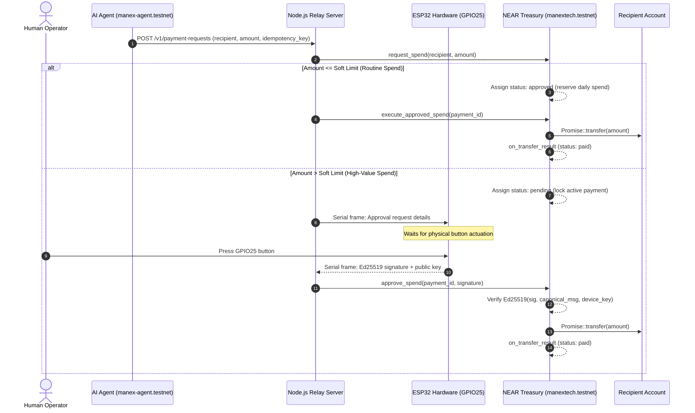

# Tapproved

[](https://explorer.testnet.near.org/accounts/manextech.testnet)
[](https://explorer.testnet.near.org/accounts/manextech.testnet)
[](https://explorer.testnet.near.org/accounts/manex-agent.testnet)
[](https://github.com/manex-tech/tapproved/actions)
[](LICENSE)

> **Hardware-backed spending authorization for autonomous AI agents on NEAR.**  
> Routine payments execute automatically within strict policy limits; elevated payments require a physical button press on an ESP32 hardware device generating an Ed25519 signature.

---

## 1. Problem & Innovation

| The AI Agent Dilemma | The Tapproved Solution |
|---|---|
| **Full Custody (Unsafe)**: Granting an AI agent an unconstrained private key means prompt injections, hallucinated transactions, or leaked credentials can drain an entire treasury in seconds. | **Tiered On-Chain Policy**: Routine transactions (`<= soft_limit_yocto`) execute autonomously; high-value payments (`> soft_limit_yocto`) are locked in `pending` on-chain until physically authorized. |
| **Full Human-in-the-Loop (Slow)**: Forcing human confirmation for every micropayment destroys autonomy and creates operational friction. | **Autonomous Within Guardrails**: Agents spend freely within pre-configured per-payment and daily spending limits, paying only allowlisted partner accounts. |
| **Software Approvals (Vulnerable)**: Traditional 2FA and push notifications to smartphones or browsers are susceptible to phishing, session hijacking, and host compromise. | **Physical Hardware Isolation**: Ed25519 private keys reside on an isolated ESP32 device that signs only after a physical button press (GPIO25). |

---

## 2. System Architecture



---

## 3. Verified Live Testnet Evidence

Tapproved is deployed and fully verified on **NEAR Testnet**:

| Milestone | Entity / Transaction | Link / Hash |
|---|---|---|
| **Treasury Contract** | `manextech.testnet` | [NEAR Explorer](https://explorer.testnet.near.org/accounts/manextech.testnet) |
| **Registered Agent** | `manex-agent.testnet` | [NEAR Explorer](https://explorer.testnet.near.org/accounts/manex-agent.testnet) |
| **Contract Deployment** | Release Wasm Code Hash | `Amp87jC1DCJjyA5bsmfEpFQzuqu72Cw7NSLRNk8uh3R5` ([Tx](https://explorer.testnet.near.org/transactions/4psHQnNteqE8SR6g9dBnSeu4smnpt3hDqXjFkzU3kzkU)) |
| **In-Place State Migration** | Guarded `migrate()` | [Tx `4AXh7BEC...`](https://explorer.testnet.near.org/transactions/4AXh7BECjmMy2X7JCmS8G3UdXbXvJMNzJNDrj6Cq87Sh) (Gas: 0.309 Tgas) |
| **Allowlist Expansion** | `add_allowed_recipient` | [Tx `CTT3bGrY...`](https://explorer.testnet.near.org/transactions/CTT3bGrY1pzw276BTwVotsoP9A9WpnzGj8z5tTXtafDp) |
| **Autonomous Request #4** | `request_spend(0.001 NEAR)` | [Tx `6FY3y24t...`](https://explorer.testnet.near.org/transactions/6FY3y24tZ21Yb8vgDsHkMQU8qqYCuo6ESeJoybLUTFUu) |
| **Settlement & Callback #4** | `execute_approved_spend(4)` | [Tx `C5fZ7UW8...`](https://explorer.testnet.near.org/transactions/C5fZ7UW8TW3nSwv8EhD4gh8GdmUpMdqvCjHAGA1fkUNi) |
| **Hardware Approval #3** | First ESP32 Button Approval | [Milestone Report](docs/TESTNET-HARDWARE-APPROVAL-MILESTONE.md) |

---

## 4. 3-Minute Quickstart & Reproducibility

### Prerequisites
- Node.js >= 22.22.2
- Git

```bash
git clone https://github.com/manex-tech/tapproved.git
cd tapproved
npm ci
npm run check
```
*Runs all 169 Node test assertions, syntax checks across SDK, relay, examples, and dashboard in ~2 seconds.*

---

## 5. Testing & Verification Guide

Tapproved offers five distinct testing pathways covering automated unit tests, simulated agent workflows, real-time UI monitoring, live on-chain queries, and physical hardware interaction.

### Option 1: Full Automated Test Suite (Fast Local Verification)
Executes all unit tests, cryptographic vector validations, SDK methods, and integration suites:
```bash
npm run check
```
- **Scope**: 169 tests across Node relay, SDK, protocol vectors, dashboard service, and autonomous agent mocks.
- **Expected Result**: 100% pass rate in ~2 seconds with zero network calls required.

### Option 2: Autonomous AI Agent Simulation Demo
Simulates an end-to-end autonomous agent session without needing physical hardware connected:
```bash
npm run agent:autonomous
```
- **Lifecycle Verified**:
  1. Agent queries live on-chain spending policy via SDK.
  2. Agent executes routine micropayments ($\le 0.01$ NEAR) with immediate autonomous approval.
  3. Agent requests an elevated payment ($> 0.01$ NEAR), transitioning the request to `pending` on-chain.
  4. Demonstrates handling of simulated physical button timeouts and recovery.
  5. Simulates an operator physical button press yielding a valid Ed25519 signature and on-chain settlement.

### Option 3: Interactive Real-Time Monitoring Dashboard
Launches the relay server and the operator web dashboard:
```bash
npm start
```
- Navigate to: **`http://localhost:3000/dashboard`**
- **Features to Explore**:
  - **Live Balances**: Inspect real-time NEAR Testnet balances for `manextech.testnet`.
  - **Quota Gauge**: Visual progress bar tracking cumulative daily spend against `daily_limit_yocto`.
  - **Pending Alerts**: Real-time pulsing banner with countdown timer when elevated payments await physical hardware confirmation.
  - **Payment Explorer**: Live transaction logs with readable NEAR conversions and direct NEAR Explorer links.
  - **Simulation Controls**: One-click simulated button press and agent spend requests directly from the UI.

### Option 4: Live NEAR Testnet CLI Inspection (Read-Only)
Inspect the canonical on-chain state directly on NEAR Testnet using `near-cli` without spending gas or modifying contract state:

1. **Inspect Spending Policy:**
   ```bash
   near contract call-function as-read-only manextech.testnet get_policy json-args '{}' network-config testnet
   ```

2. **Inspect Current Daily Quota Usage:**
   ```bash
   near contract call-function as-read-only manextech.testnet get_daily_usage json-args '{"day": 20758}' network-config testnet
   ```

3. **Inspect Latest Settled Payment (#4):**
   ```bash
   near contract call-function as-read-only manextech.testnet get_payment json-args '{"payment_id": 4}' network-config testnet
   ```

4. **Inspect Treasury Storage Staking & Headroom:**
   ```bash
   near contract call-function as-read-only manextech.testnet get_storage_metrics json-args '{}' network-config testnet
   ```

### Option 5: Live Physical Hardware Testing (ESP32 via USB)
*For operators testing with the physical ESP32-WROOM-32 hardware device:*

1. Connect the ESP32 board to your computer via micro-USB.
2. Identify the assigned serial port (e.g. `COM11` on Windows, `/dev/ttyUSB0` on Linux/macOS).
3. Wire a momentary push button between **GPIO 25** and **GND** (ESP32 internal pull-up is active; no external resistor required).
4. Run the automated hardware verification utility:
   ```bash
   npm run test:hardware
   ```
   *Transmits a live approval challenge over serial. Press and release the physical button to verify the on-device Ed25519 signature in real time!*
5. Configure your local `.env`:
   ```ini
   SERIAL_PORT=COM11
   SERIAL_BAUD_RATE=115200
   ```
6. Start the relay:
   ```bash
   npm start
   ```
7. Open **`http://localhost:3000/dashboard`**, navigate to **`[02_AGENT_PLAYGROUND]`**, and click **`[TEST ELEVATED SPEND (0.05 NEAR)]`**. Press the GPIO25 button on your breadboard to watch the real-time hardware signature capture and instant ledger settlement!

---

## 6. AI Agent SDK

The official SDK (`sdk/index.js`, `sdk/index.d.ts`) provides clean, strongly-typed interfaces for agentic frameworks:

```javascript
import { TapprovedClient } from "tapproved/sdk";

const client = new TapprovedClient({
  relayUrl: "http://127.0.0.1:3000",
  token: process.env.AGENT_API_TOKEN
});

// 1. Inspect spending policy
const policy = await client.getPolicy();
console.log("Daily Limit:", policy.daily_limit_yocto);

// 2. Request an autonomous payment
const result = await client.requestPayment({
  recipientId: "merchant.testnet",
  amountYocto: "5000000000000000000000" // 0.005 NEAR
});

// 3. Await resolution with pending-approval notification hooks
const payment = await client.waitForPaymentResolution(result.payment.id, {
  onPendingApproval: (pending) => {
    console.log(`[ALERT] Payment ${pending.id} awaiting physical ESP32 button press!`);
  }
});
console.log("Settlement Status:", payment.status); // 'paid'
```

See the [Agent Integration Guide](docs/AGENT-INTEGRATION.md) for error hierarchies, typed definitions, and idempotency guarantees.

---

## 7. Real-Time Dashboard

The dashboard provides operators with complete situational awareness over agent activity:

- **Treasury Telemetry**: Live NEAR native balance, available balance, storage staking reserve, and storage headroom.
- **Daily Quota Progress**: Visual percentage bar tracking cumulative spend + reservations against `daily_limit_yocto`.
- **Active Pending Approval Banner**: Real-time pulsing alert with countdown timer whenever a high-value payment is awaiting physical ESP32 button confirmation.
- **Payment History Table**: Comprehensive log of all payments, showing amounts in readable NEAR and exact yoctoNEAR, statuses (`paid`, `approved`, `pending`, `expired`), timestamps, and hardware-signed badges.
- **Owner Governance Generator**: Interactive tool to generate executable `near-cli-rs` commands for emergency pause/unpause, allowlist management, and spending limit updates.
- **Transaction Explorer**: Query any NEAR transaction hash for execution receipts and finality status.

---

## 8. Security Architecture & Threat Model

| Threat Scenario | Defense & Mitigation | Documented In |
|---|---|---|
| **Agent Key Theft** | Blast radius is strictly capped by per-payment soft limit and daily spending limit. Attacker can only pay pre-approved allowlist recipients. Owner can freeze treasury via `pause()` or rebind agent key via `set_agent()`. | [Threat Model §2.1](docs/SECURITY-THREAT-MODEL.md) |
| **Hardware Key Extraction** | Signatures cannot conjure payments or bypass on-chain policy. Signatures are accepted only if a payment is already created by the agent in `pending` state and within the 5-minute expiry window. Owner can rotate device key atomically via `rotate_device_key()`. | [Threat Model §2.2](docs/SECURITY-THREAT-MODEL.md) |
| **Signature Replay** | The canonical payload cryptographically binds `payment_id`, `recipient_id`, `amount_yocto`, `nonce`, `expires_at_ns`, `contract_id`, and `network_id`. Signatures cannot be replayed on mainnet or across payments. | [Threat Model §2.4](docs/SECURITY-THREAT-MODEL.md) |
| **Relay Compromise** | Relay possesses zero spending authority. Tampering with serial payloads invalidates the Ed25519 signature on-chain. Stalled payments expire safely without loss of funds. | [Threat Model §2.5](docs/SECURITY-THREAT-MODEL.md) |
| **Storage Exhaustion** | Storage uses $O(1)$ `LookupMap` collections; daily usage is pruned after 90 days; allowlist is capped at 100 recipients; `get_storage_metrics` monitors available headroom (~2.42 NEAR). | [Threat Model §3](docs/SECURITY-THREAT-MODEL.md) |

---

## 9. Master Documentation Sitemap

- [NEAR Hackathon Submission & Architecture](docs/HACKATHON.md) — Comprehensive hackathon overview, innovation summary, and submission metadata.
- [Official Demo Video Script & Storyboard](docs/DEMO-VIDEO-SCRIPT.md) — Scene-by-scene script, visual directions, and timestamps for hackathon video submission.
- [Security Threat Model & Analysis](docs/SECURITY-THREAT-MODEL.md) — Formal trust boundaries, threat scenarios, and blast-radius mitigations.
- [AI Agent Integration Guide](docs/AGENT-INTEGRATION.md) — Complete SDK documentation, idempotency rules, and error codes.
- [Master Development Checklist](docs/MASTER-DEVELOPMENT-CHECKLIST.md) — Canonical task-by-task execution evidence, CI run URLs, and milestone logs.
- [Testnet Deployment Runbook](docs/TESTNET-DEPLOYMENT.md) — Exact operator runbook for contract deployment, state migration, and verification.
- [Hardware Approval Milestone](docs/TESTNET-HARDWARE-APPROVAL-MILESTONE.md) — Verified evidence of the first end-to-end physical ESP32 approval.
- [Approval Protocol v1](docs/APPROVAL-PROTOCOL.md) — Canonical binary serialization and deterministic Ed25519 test vectors.
- [ESP32 Security Assessment](docs/ESP32-SECURITY-ASSESSMENT.md) — Physical micro-controller security, NVS key storage, and memory zeroization.
- [Device Key Rotation](docs/DEVICE-KEY-ROTATION.md) — Operational runbook for zero-downtime hardware key rotation.

---

## 10. License

This project is licensed under the [MIT License](LICENSE).
